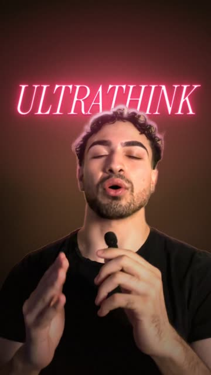
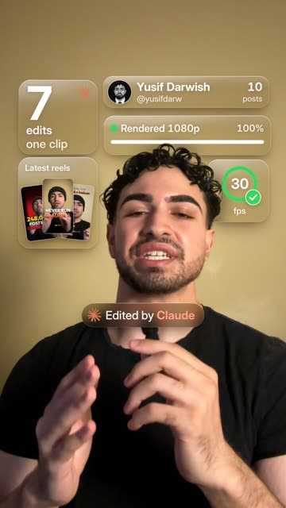
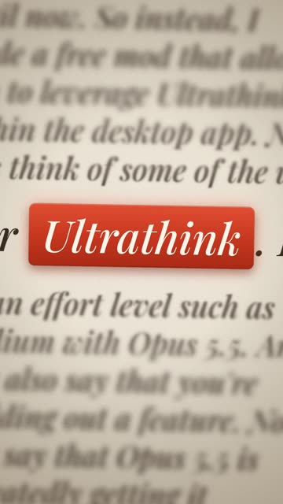
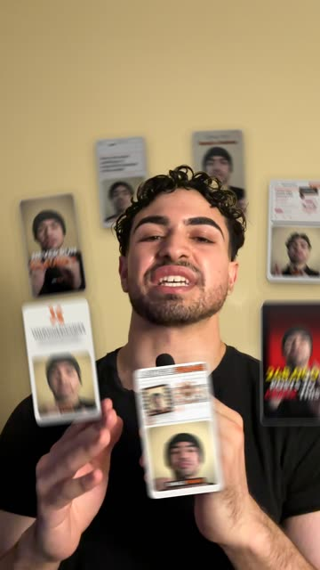
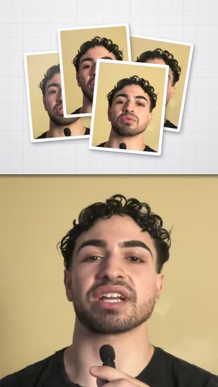
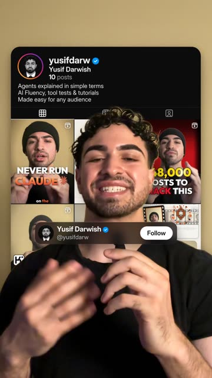
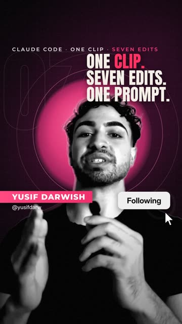
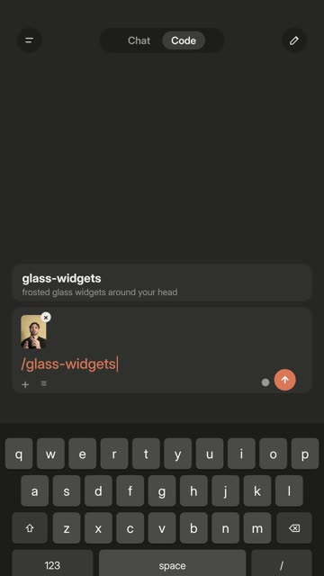
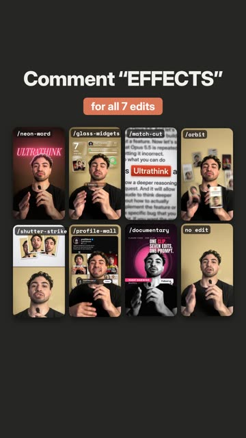

# Claude Video Effects

Premium effects for talking-head videos, made in Claude Code. One clip in, one finished effect out, each one a
single slash command. Every effect follows you (face tracking and a cut-out, so graphics go behind your head), and
every effect has its own sound hit, synced to the frame.

By Yusif Darwish ([@yusifdarw](https://instagram.com/yusifdarw)).

| | | |
|---|---|---|
| <br>**/neon-word**<br>The room goes dark and a neon word lights up behind you. | <br>**/glass-widgets**<br>Frosted glass widgets float around your head. | <br>**/match-cut**<br>Pages cut fast; one word stays locked in a red box. |
| <br>**/orbit**<br>Your reels circle your head, behind and in front. | <br>**/shutter-strike**<br>Photo prints of you strike a light table with a flash. | <br>**/profile-wall**<br>Your profile page on the wall behind your head. |
| <br>**/documentary**<br>A black-and-white doc poster; Follow gets tapped. | <br>**/app-frame**<br>Any effect, opened as a typed command in the Claude app. | <br>**/effects-grid**<br>All your edits at once, for the hook and the end card. |

## Install

In Claude Code:

```
/plugin marketplace add ydarwish1/claude-video-effects
/plugin install reel-effects@yusif-video-effects
```

Then restart Claude Code. The first time you use an effect, Claude runs the setup (2-5 minutes: Python libraries,
a headless browser, two models and the sounds). You need ffmpeg, Node.js 18+ and Python 3.11-3.13; Claude installs
them for you if they are missing.

## Use it

Drag your video into Claude Code and ask for an effect by name, or type its skill (plugin skills carry the plugin's
name, reel-effects, in front):

```
/reel-effects:neon-word from 3 to 5.5 seconds, the word ULTRATHINK
/reel-effects:glass-widgets on 12-14.3 s, my name Ada Lovelace, @ada, 42 posts, my avatar is ada.jpg
add the orbit effect at 20 s with my 7 reel covers in ./covers
```

Claude prepares the clip (crop to 9:16, cut-out, face track), checks a few stills, renders the MP4 next to your
video and checks it: every sound within one frame of its picture, no text outside Instagram's safe area, no text
over your face.

For a whole "one clip, N edits" reel: wrap each effect with `/app-frame`, then build the opening and the end card
with `/effects-grid` and join them.

## Notes
- It drafts, you approve. Watch the result before you post.
- Use your own names, numbers and pictures; the effects never invent stats.
- Fonts, models and sounds keep their own licences: see THIRD-PARTY.md.
